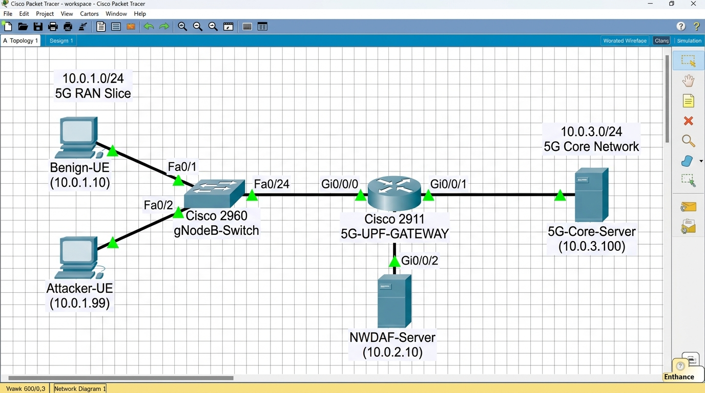

# 🌐 Cisco Packet Tracer Integration Guide: 5G UPF Network Defense

This guide provides step-by-step instructions for building and demonstrating the **5G User Plane Function (UPF) Intrusion Detection and Mitigation Topology** in Cisco Packet Tracer.

---

## 1. Network Topology Overview

The topology represents a **3GPP 5G Network Slice** connecting User Equipment (UE) through a gNodeB to the **5G Core UPF Gateway (Cisco 2911 Router)** and the destination Application Server.



```text
               [Legitimate UE] 
               10.0.1.10/24
                    │
                    ▼ FastEthernet0/1
            [Cisco 2960 Switch] ──(Fa0/24)──► Gi0/0/0 [Cisco 2911 Router] Gi0/0/1 ──► [5G Core Server]
                    ▲                           (Host: 5G-UPF-GATEWAY)             10.0.3.100/24
                    │ FastEthernet0/2                     │ (Gi0/0/2)
               [Attacker UE]                              ▼
               10.0.1.99/24                       [NWDAF Analytics PC]
                                                   10.0.2.10/24
```

---

## 2. IP Addressing & Interface Specification

| Device Name | Device Model | Interface | IP Address | Subnet Mask | Default Gateway | Role |
| :--- | :--- | :--- | :--- | :--- | :--- | :--- |
| **5G-UPF-GATEWAY** | Cisco 2911 Router | `Gi0/0/0` | `10.0.1.1` | `255.255.255.0` | N/A | Ingress Gateway (RAN / gNodeB side) |
| **5G-UPF-GATEWAY** | Cisco 2911 Router | `Gi0/0/1` | `10.0.3.1` | `255.255.255.0` | N/A | Egress Gateway (Data Network / Server) |
| **5G-UPF-GATEWAY** | Cisco 2911 Router | `Gi0/0/2` | `10.0.2.1` | `255.255.255.0` | N/A | Management / NWDAF Telemetry Bus |
| **Benign-UE** | PC / Laptop | `FastEth0` | `10.0.1.10` | `255.255.255.0` | `10.0.1.1` | Simulates normal mobile user (HTTP/VoLTE) |
| **Attacker-UE** | PC / Laptop | `FastEth0` | `10.0.1.99` | `255.255.255.0` | `10.0.1.1` | Simulates SYNScan / DoS attacker |
| **NWDAF-Server** | Server / PC | `FastEth0` | `10.0.2.10` | `255.255.255.0` | `10.0.2.1` | Runs Python ML Detection & Exporter |
| **5G-Core-Server** | Server | `FastEth0` | `10.0.3.100` | `255.255.255.0` | `10.0.3.1` | Protected Core Server (HTTP/SSH) |

---

## 3. Step-by-Step Packet Tracer Setup Instructions

### Step 1: Place Devices
1. From the bottom-left menu, drag:
   * **1x Router:** `2911` (rename to `5G-UPF-GATEWAY`)
   * **1x Switch:** `2960-24TT` (rename to `gNodeB-Switch`)
   * **3x End Devices (PC):** Rename to `Benign-UE`, `Attacker-UE`, and `NWDAF-Server`
   * **1x Server:** Rename to `5G-Core-Server`

### Step 2: Cable Connections (Copper Straight-Through)
* Connect `Benign-UE` (`FastEthernet0`) $\to$ `gNodeB-Switch` (`FastEthernet0/1`)
* Connect `Attacker-UE` (`FastEthernet0`) $\to$ `gNodeB-Switch` (`FastEthernet0/2`)
* Connect `gNodeB-Switch` (`FastEthernet0/24`) $\to$ `5G-UPF-GATEWAY` (`GigabitEthernet0/0/0`)
* Connect `5G-UPF-GATEWAY` (`GigabitEthernet0/0/1`) $\to$ `5G-Core-Server` (`FastEthernet0`)
* Connect `5G-UPF-GATEWAY` (`GigabitEthernet0/0/2`) $\to$ `NWDAF-Server` (`FastEthernet0`)

---

## 4. Cisco 2911 Router Base Configuration

Click on `5G-UPF-GATEWAY`, switch to the **CLI** tab, press Enter, and paste the following baseline configuration:

```cisco
enable
configure terminal
hostname 5G-UPF-GATEWAY

! 1. Configure Ingress Interface (RAN / gNodeB side)
interface GigabitEthernet0/0/0
 ip address 10.0.1.1 255.255.255.0
 no shutdown
 exit

! 2. Configure Egress Interface (Data Network / 5G Core Server)
interface GigabitEthernet0/0/1
 ip address 10.0.3.1 255.255.255.0
 no shutdown
 exit

! 3. Configure Management / NWDAF Analytics Interface
interface GigabitEthernet0/0/2
 ip address 10.0.2.1 255.255.255.0
 no shutdown
 exit

end
write memory
```

---

## 5. End Device IP Configurations

1. **Benign-UE:**
   * IP: `10.0.1.10`
   * Subnet Mask: `255.255.255.0`
   * Default Gateway: `10.0.1.1`

2. **Attacker-UE:**
   * IP: `10.0.1.99`
   * Subnet Mask: `255.255.255.0`
   * Default Gateway: `10.0.1.1`

3. **5G-Core-Server:**
   * IP: `10.0.3.100`
   * Subnet Mask: `255.255.255.0`
   * Default Gateway: `10.0.3.1`
   * *Services Tab:* Ensure **HTTP** and **DNS** services are set to **ON**.

---

## 6. How to Run the Demonstration (Before vs. After Defense)

### Part A: Baseline (Before Defense)
1. Open `Attacker-UE` $\to$ **Desktop** $\to$ **Command Prompt**.
2. Run ping to Core Server:
   ```cmd
   ping 10.0.3.100
   ```
   *Result:* Ping succeeds (4 replies received).
3. Open **Web Browser** on `Attacker-UE`, type `http://10.0.3.100`.
   *Result:* The Cisco test webpage loads successfully.

---

### Part B: Enforcing the Generated Mitigation ACL
1. In your Python project, run:
   ```bash
   python network_defense_exporter.py
   ```
2. Open the newly generated [cisco_defense.ios](cisco_defense.ios) file.
3. Open `5G-UPF-GATEWAY` $\to$ **CLI**, and paste the ACL:

```cisco
enable
configure terminal

ip access-list extended 5G_UPF_MITIGATION
 remark *** 5G Core User Plane Function (UPF) Ingress Filter ***
 deny tcp any 10.0.3.0 0.0.0.255 syn
 deny udp any 10.0.3.0 0.0.0.255 eq 53
 permit tcp any any established
 permit ip any any

interface GigabitEthernet0/0
 ip access-group 5G_UPF_MITIGATION in
 exit

end
write memory
```

---

### Part C: Verification (After Defense)
1. On `Attacker-UE`, try to connect to the Web Server:
   * Open **Web Browser**, enter `http://10.0.3.100`.
   * *Result:* **Request Timeout!** The TCP SYN handshake packet is immediately dropped by `GigabitEthernet0/0`.
2. Check router drop counters in `5G-UPF-GATEWAY` CLI:
   ```cisco
   show ip access-lists 5G_UPF_MITIGATION
   ```
   *Result:* You will see match counters incrementing:
   ```text
   Extended IP access list 5G_UPF_MITIGATION
       10 deny tcp any 10.0.3.0 0.0.0.255 syn (4 matches)
       20 deny udp any 10.0.3.0 0.0.0.255 eq 53
       30 permit tcp any any established
       40 permit ip any any
   ```
3. On `Benign-UE`, ping `10.0.3.100`:
   * *Result:* Ping succeeds (`permit ip any any`), confirming **zero disruption to legitimate traffic**!

---

## 7. Capturing Screenshots for Your 30-Mark Report

For maximum marks, include these 3 screenshots in your case study submission:

1. **Topology Diagram Screenshot:** The complete layout showing all connected green link lights.
2. **Simulation Mode PDU Inspection:**
   * Switch Packet Tracer to **Simulation Mode** (bottom-right icon).
   * Send a packet from `Attacker-UE` to `5G-Core-Server`.
   * Click on the envelope at the router interface.
   * Screenshot the **Layer 3 (IP) and Layer 4 (TCP)** PDU details showing:
     * `Source IP: 10.0.1.99`, `Dest IP: 10.0.3.100`
     * `Flags: SYN=1`
     * Outbound PDU showing **Red Cross (❌ Packet Dropped by ACL)**.
3. **CLI Verification Screenshot:** Output of `show ip access-lists 5G_UPF_MITIGATION` showing active deny match counts.
